# 🛡️ Active Directory Home Lab – Attack Simulation & Detection Engineering

A hands-on Security Operations (SOC) home lab built to simulate real-world adversary behavior against an Active Directory environment, and to build/validate detections for that behavior in Splunk. This project follows the MyDFIR AD home lab methodology and extends it with custom detection queries and documented evidence for each stage of the attack chain.

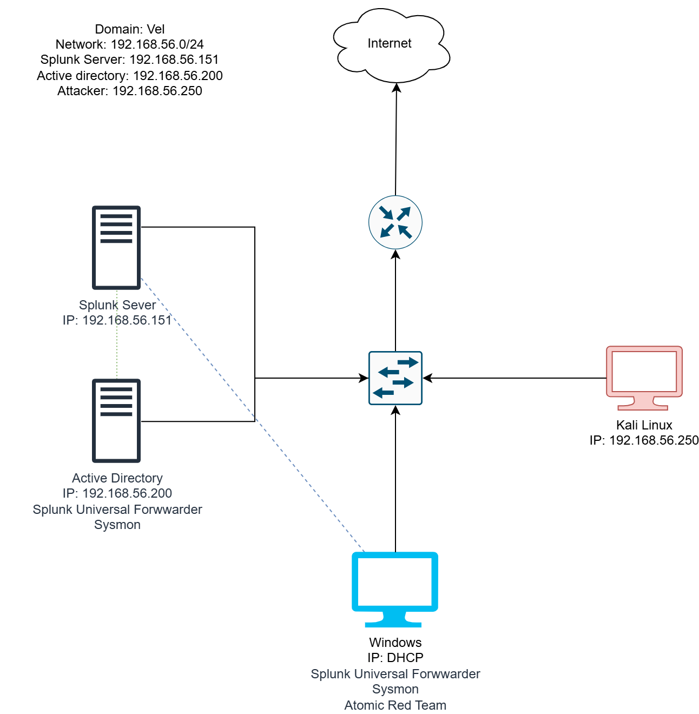

---

## 📌 Project Objectives

- Build a realistic small AD environment (DC, Windows endpoint, SIEM, attacker box)
- Simulate common adversary techniques mapped to MITRE ATT&CK
- Forward endpoint telemetry (Sysmon + Windows Event Logs) into Splunk
- Write and test detection searches (SPL) for each attack technique
- Document every step with command-line evidence and search results, so the lab is fully reproducible

---

## 🧱 Lab Architecture

| Host | Role | IP Address |
|---|---|---|
| **Domain Controller** | Active Directory (Domain: `VEL`) | `192.168.56.200` |
| **Splunk Server** | SIEM / Log Aggregation | `192.168.56.151` |
| **Windows Endpoint** | Domain-joined workstation (target) | DHCP |
| **Kali Linux** | Attacker machine | `192.168.56.250` |

**Network:** `192.168.56.0/24` (isolated host-only VirtualBox network)

**Telemetry pipeline on both AD and the Windows endpoint:**
- Splunk Universal Forwarder
- Sysmon (process creation, registry, network events)

**Tooling on Windows endpoint:**
- Atomic Red Team (adversary emulation)

---

## 🧰 Tools & Technologies

| Category | Tool |
|---|---|
| Virtualization | VirtualBox |
| SIEM | Splunk Enterprise 10.6.1.1 |
| Log forwarding | Splunk Universal Forwarder |
| Endpoint telemetry | Sysmon |
| Adversary emulation | Atomic Red Team (Invoke-AtomicTest) |
| Credential attack / brute force | Crowbar |
| Wordlist | rockyou.txt |
| Attack OS | Kali Linux |
| Target OS | Windows 10/11 (domain-joined) |
| Directory service | Active Directory Domain Services |

---

## ⚔️ Attack Simulations Performed

### 1. RDP Credential Brute Force — MITRE ATT&CK [T1110.001](https://attack.mitre.org/techniques/T1110/001/) — *Brute Force: Password Guessing*

Simulated a credential-guessing attack against the Windows endpoint's RDP service from the Kali attacker box.

**Install Crowbar:**
```bash
sudo apt-get install -y crowbar
```
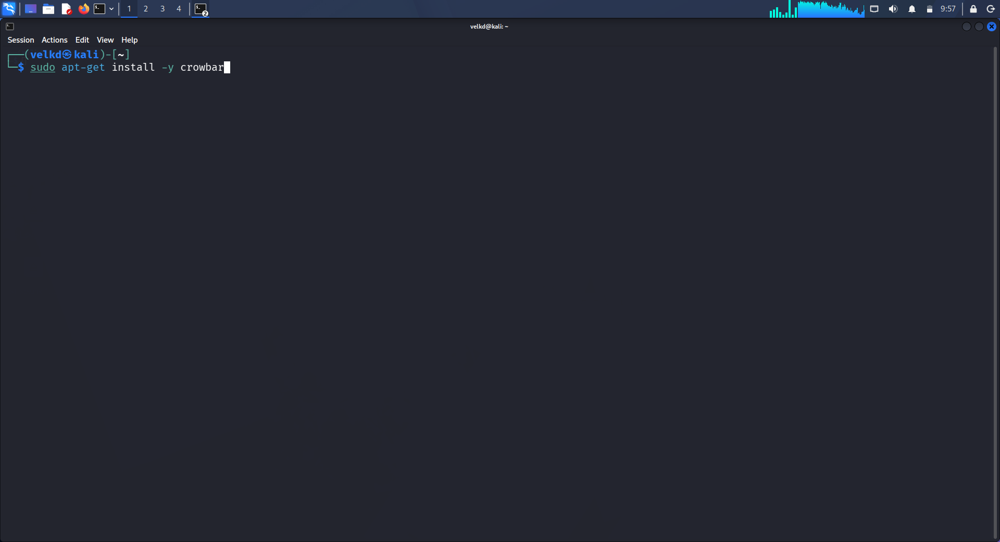

**Wordlist preparation:**
```bash
cp /usr/share/wordlists/rockyou.txt ~/ad-project/
head -n 20 rockyou.txt > password.txt
```
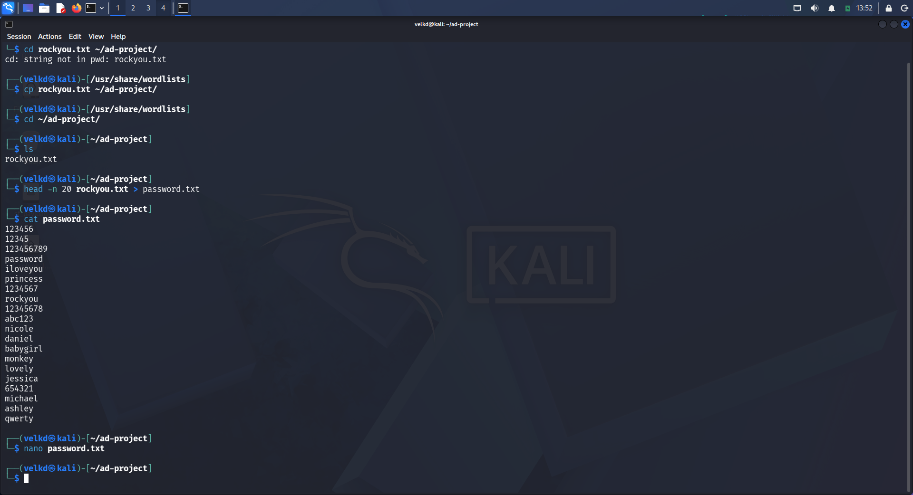

**Baseline attempt (invalid/test username, full host):**
```bash
crowbar -b rdp -u tsmith -c password.txt
```
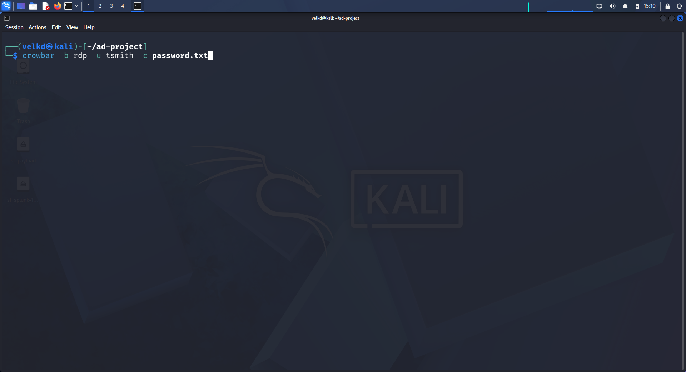

**Targeted brute force against a valid domain account, scoped to a single host:**
```bash
crowbar -b rdp -u vanand -C password.txt -s 192.168.56.150/32
```
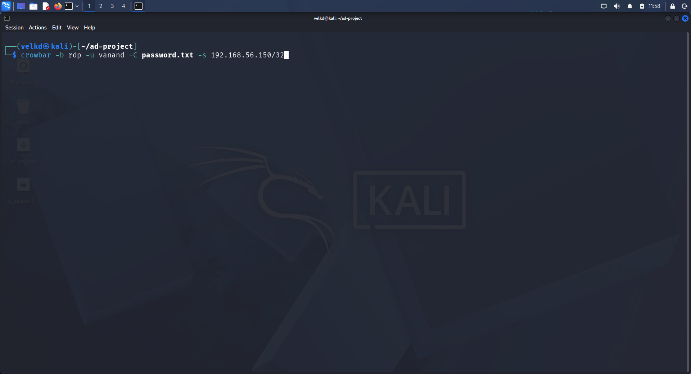

---

### 2. Local Account Creation — MITRE ATT&CK [T1136.001](https://attack.mitre.org/techniques/T1136/001/) — *Create Account: Local Account*

Simulated an adversary creating a persistence account on the compromised Windows host using **Atomic Red Team**.

**Install Atomic Red Team:**
```powershell
Install-AtomicRedTeam -getAtomics -force
```
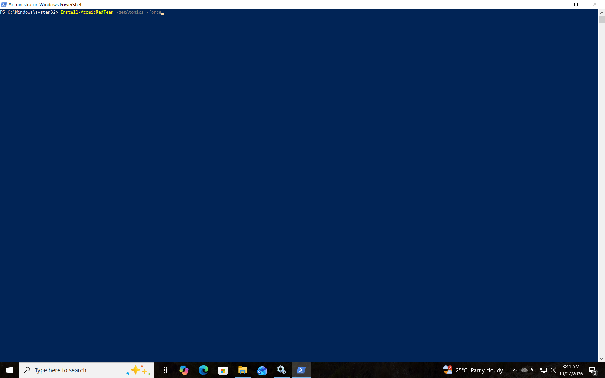

**Execute T1136.001 test suite:**
```powershell
Invoke-AtomicTest T1136.001
```

Sub-tests executed:
- `T1136.001-4` – Create a new user via `cmd.exe` (failed — password policy enforced ✅ expected defensive control working)
- `T1136.001-5` – Create a new user via PowerShell (`T1136.001_PowerShell`)
- `T1136.001-8` – Create a new Windows admin user
- `T1136.001-9` – Create a new Windows admin user via .NET (account `NewLocalUser` created, added to `Administrators`, then deleted)

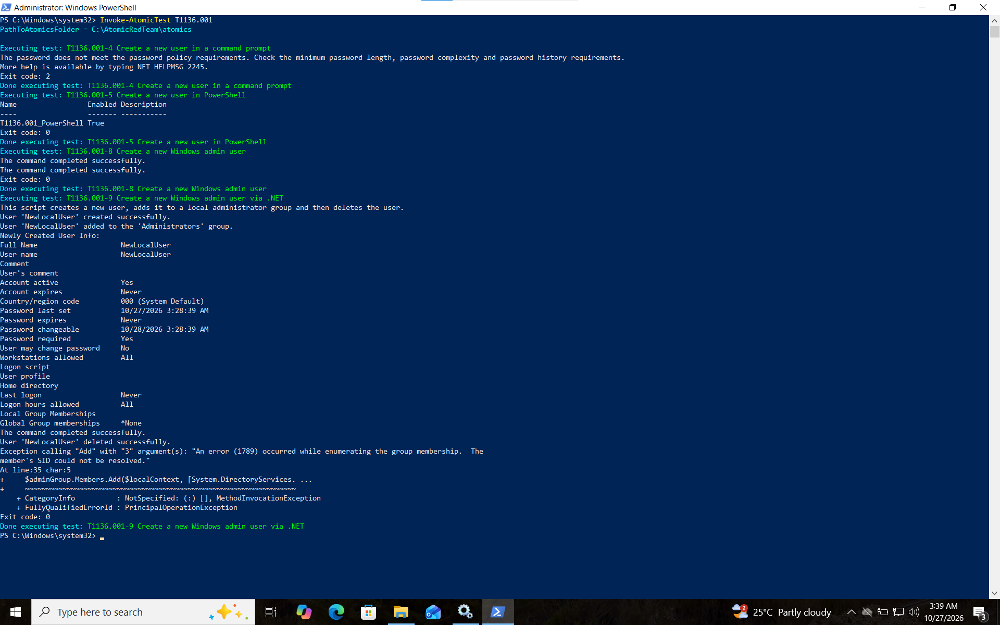

---

### 3. Remote Desktop Access Configuration

Reviewed and documented how Remote Desktop access is granted on the domain, to understand the attack surface before/after simulation.

**Reviewing existing Remote Desktop Users on the target:**
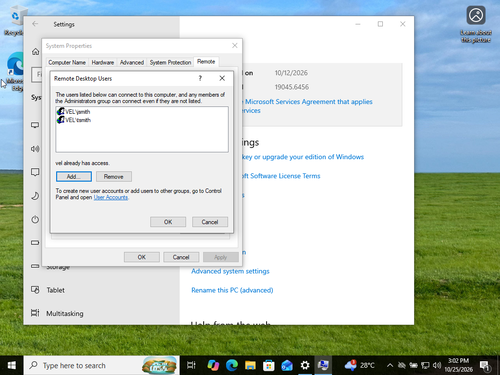

**Adding a domain user via Select Users or Groups (`vel.local`):**
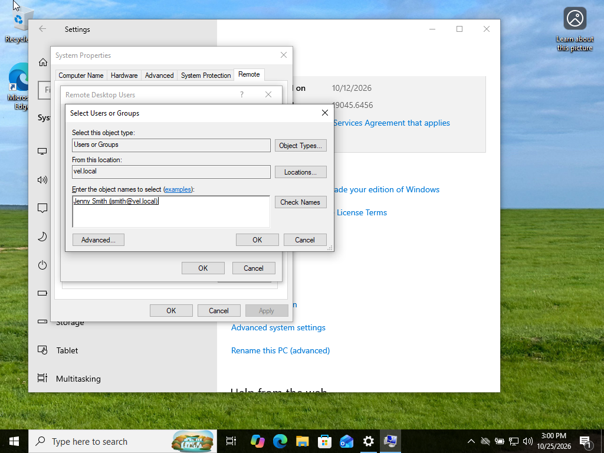

---

## 🔎 Detection Engineering in Splunk

All detections were built against the `endpoint` index, sourced from `WinEventLog:Security` and `WinEventLog:Microsoft-Windows-Sysmon/Operational`. Full SPL for each detection is in [`spl-queries/`](spl-queries/).

### Detection 1 — Failed Logon Attempts (Brute Force Indicator)

```spl
index="endpoint" vanand EventCode=4625
```

- **48 events** returned over 24 hours for account `vanand`
- Confirms repeated authentication failures consistent with a password-guessing/brute-force attempt
- Key fields: `Account_Name`, `Account_Domain`, `Failure_Reason`, `ComputerName`

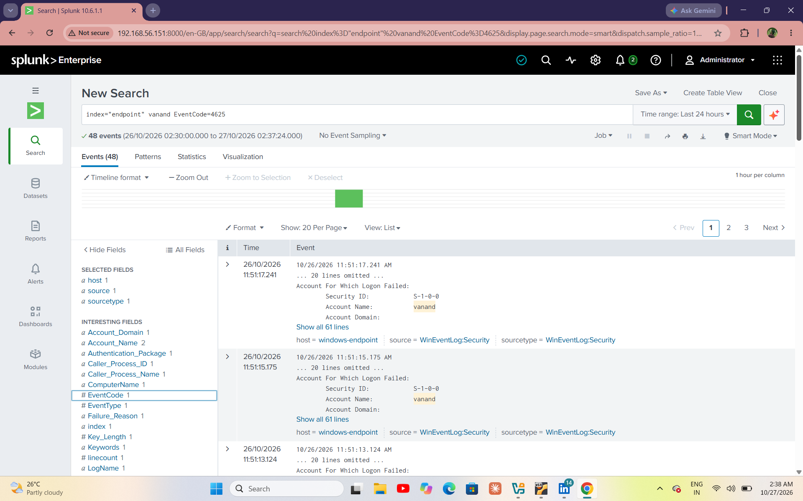

📄 Production detection query: [`spl-queries/failed-logon-4625.spl`](spl-queries/failed-logon-4625.spl)

### Detection 2 — Successful Logon Following Failures (Compromise Indicator)

```spl
index="endpoint" vanand EventCode=4624
```

- **2 successful logon events** for `vanand` on domain `VEL`, immediately following the failed-logon spike
- This failed→success pattern is the core brute-force-success detection logic and the basis for the correlation search below

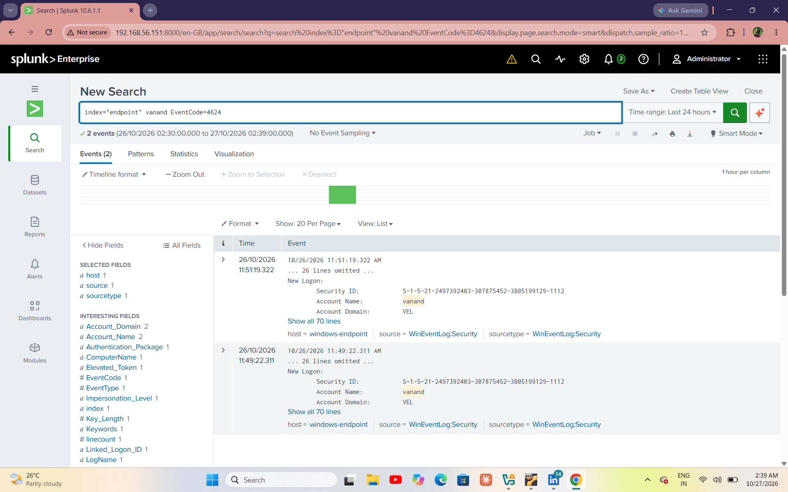

📄 Production detection query: [`spl-queries/successful-logon-4624.spl`](spl-queries/successful-logon-4624.spl)

### Detection 3 — Local Account Creation (Persistence Indicator)

```spl
index="endpoint" NewLocalUser
```

- **14 events** captured in a 15-minute window
- Correlates Windows Security EventCode 4720/4732 (account creation / added to group) with Sysmon EventCode 1 (process creation) and EventCode 12/13 (registry object creation under `HKLM\SAM\SAM\Domains\Account\Users\Names`)
- Demonstrates full attack-chain visibility: command execution → registry artifact → security event

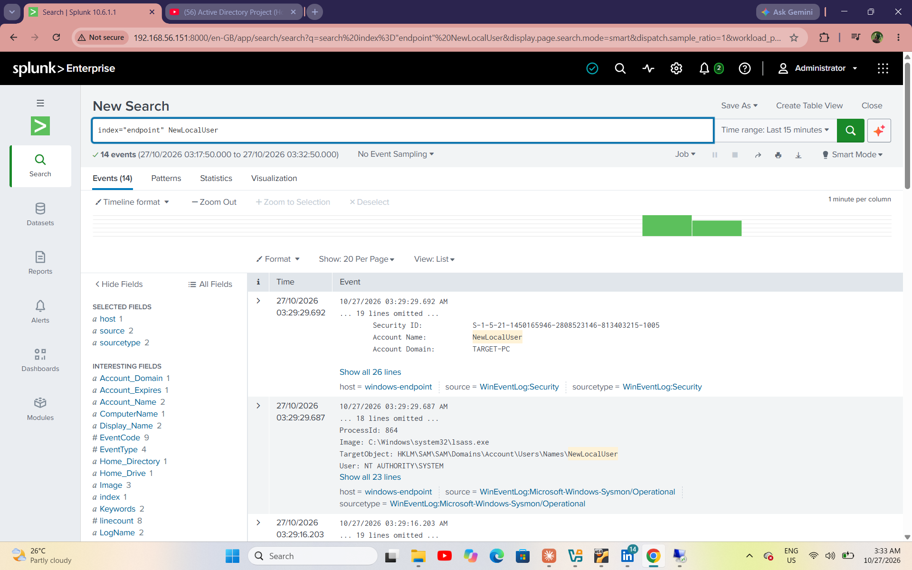

📄 Production detection query: [`spl-queries/new-local-user.spl`](spl-queries/new-local-user.spl)

---

## 🗺️ Attack Chain Summary

| Stage | MITRE ATT&CK | Action | Detected Via |
|---|---|---|---|
| 1 | T1110.001 – Brute Force | RDP password guessing (Crowbar) | EventCode 4625 (failed logon) |
| 2 | — | Successful RDP authentication | EventCode 4624 (successful logon) |
| 3 | T1136.001 – Create Account | Local admin account creation (Atomic Red Team) | EventCode 4720/4732 + Sysmon registry/process events |

---

## 🧠 Skills Demonstrated

- **Lab/infrastructure build:** Designed and deployed a segmented AD lab in VirtualBox (DC, SIEM, Windows endpoint, attacker VM) with host-only networking
- **Active Directory administration:** Domain setup, user/group management, RDP access configuration (Remote Desktop Users)
- **Log forwarding & telemetry:** Configured Splunk Universal Forwarder and Sysmon across multiple hosts to centralize Security and Sysmon event logs
- **Adversary emulation:** Used Atomic Red Team to safely execute real ATT&CK technique procedures (T1136.001) and observe their telemetry footprint
- **Offensive tooling:** Performed RDP brute-force attacks with Crowbar using a curated wordlist derived from rockyou.txt
- **SIEM / SPL:** Wrote and validated Splunk searches (`index`, `EventCode`, `transaction`, `stats`) to detect brute force, successful logons, and account-creation persistence
- **Detection engineering mindset:** Mapped each attack step to a corresponding detection query and a MITRE ATT&CK technique ID, rather than just "running tools"
- **Documentation:** Captured reproducible, timestamped evidence for every stage — the standard expected in SOC/IR reporting

---

## 📂 Repository Structure

```
.
├── README.md
├── LICENSE
├── .gitignore
├── images/
│   ├── network-diagram.png
│   ├── wordlist-prep.png
│   ├── crowbar-install.png
│   ├── crowbar-rdp-attempt-tsmith.png
│   ├── crowbar-rdp-bruteforce.png
│   ├── atomic-redteam-install.png
│   ├── atomic-t1136-001-execution.png
│   ├── rdp-users-config.png
│   ├── rdp-add-user.png
│   ├── splunk-4625-failed-logon.png
│   ├── splunk-4624-successful-logon.png
│   └── splunk-newlocaluser-detection.png
└── spl-queries/
    ├── failed-logon-4625.spl
    ├── successful-logon-4624.spl
    └── new-local-user.spl
```

---

## 🚀 Next Steps / Future Work

- [ ] Automate the failed→success correlation search as a scheduled Splunk alert
- [ ] Add a Splunk dashboard panel summarizing brute-force attempts by source/account
- [ ] Extend Atomic Red Team coverage to additional techniques (e.g., T1078 – Valid Accounts, T1021.001 – RDP lateral movement)
- [ ] Add Sigma rules for portability to other SIEMs
- [ ] Write an incident timeline/report (IR-style) for the simulated intrusion

---

## 📖 Credit

Lab methodology based on the [MyDFIR](https://www.youtube.com/@MyDFIR) Active Directory home lab series, extended with original detection content and documentation by the repository author.

## 📄 License

This project is licensed under the MIT License — see [LICENSE](LICENSE) for details.
